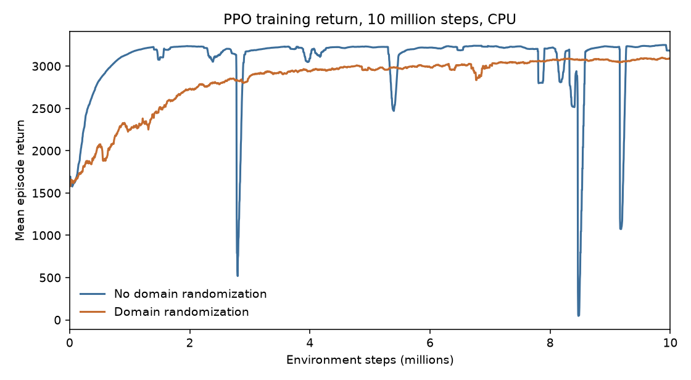
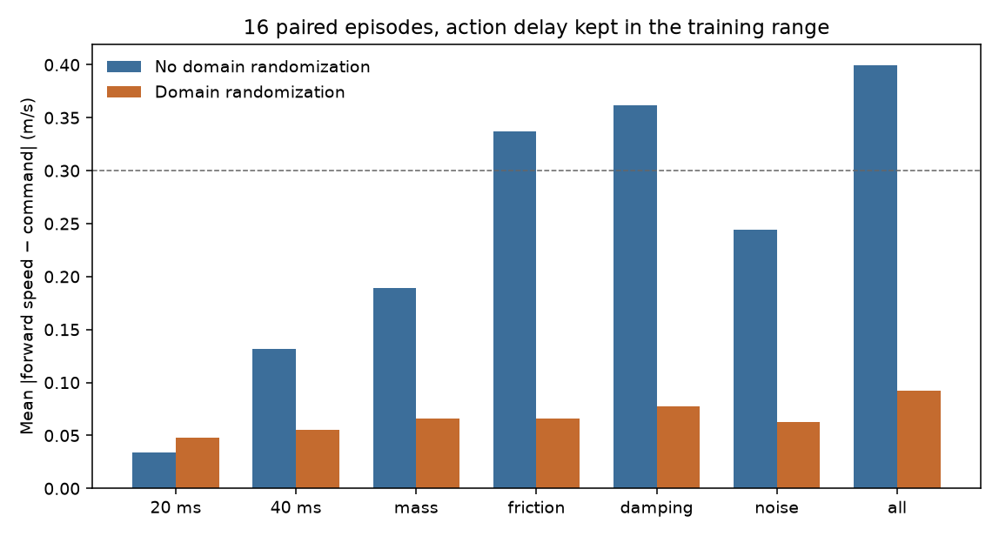
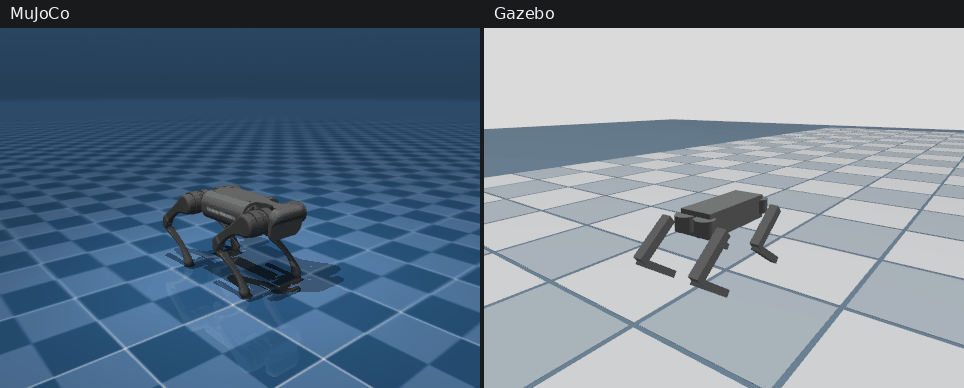

# Quadruped locomotion: PPO in MuJoCo, CPU only

Train a 12-DoF Unitree A1 to track a forward speed command. Physics is MuJoCo. The policy is PPO (Stable-Baselines3) on the **CPU build of PyTorch**. The same actor is then replayed in Gazebo, and the speed gap is measured. See [docs/gazebo_transfer.md](docs/gazebo_transfer.md).

> [!WARNING]
> Do not `pip install torch` from PyPI on Linux. That wheel is the CUDA build, several gigabytes. This repo installs `torch==2.14.1+cpu` from the PyTorch CPU index. The training entry point refuses to start on a CUDA build.

Isaac Lab, a physical robot, and Micro-ROS are out of this version.

## What runs today

- Gymnasium environment `QuadrupedEnv` on the MuJoCo Menagerie A1 (BSD-3-Clause, copyright Unitree). Scene: `assets/unitree_a1/scene.xml`.
- 50 Hz residual position targets around the `home` keyframe, tracked by the MJCF position actuators (`kp=100`).
- Reward: stay-up bonus, velocity tracking, yaw tracking, upright trunk, energy, action rate, fall penalty.
- Domain randomization at reset: mass, ground and foot friction, joint damping, IMU and encoder noise, action latency (10–40 ms, which is 1 or 2 control steps at 50 Hz).
- PPO training, evaluation, and ONNX export of the actor mean, all forced onto CPU.

Two policies are saved, each from 10 million CPU steps on 8 processes (about 70 minutes). The zip archives, their observation statistics, and the ONNX actors are in `models/`, so a clone can replay the walks without training again. `models/walk_baseline.zip` was trained without domain randomization. On the nominal floor it tracks the commanded speed within 0.014 m/s. `models/walk_dr.zip` was trained with every randomization axis on. On 16 episodes drawn from that joint distribution it tracks within 0.092 m/s (16 of 16). The baseline on the same episodes is at 0.399 m/s (5 of 16). With action delay removed, the randomized policy walks at about 0.16 m/s. The paired comparison is in [docs/dr_comparison.md](docs/dr_comparison.md). In Gazebo, on one 20 s episode per command, both policies track 0.40 and 0.55 m/s. At 0.70 m/s the baseline slows to 0.21 m/s and stops in the second half, while `walk_dr` stays at 0.64 m/s. No episode fell. Detail in [docs/gazebo_transfer.md](docs/gazebo_transfer.md).

## Results

Training return from the TensorBoard logs of the two finished runs. Blue is `walk_baseline` (final mean return about 3170). Orange is `walk_dr` (about 1580 at the start, about 3090 at the end). The sharp drops on the blue curve, including one near zero around 8.3 million steps, are in the log.



Speed error when action delay stays inside the range used in training (1 or 2 control steps). The dashed line is the 0.3 m/s success threshold. The randomized policy stays under 0.10 m/s on every bar. Tables are in [docs/dr_comparison.md](docs/dr_comparison.md).



One 20 s episode per command. The tall bar is the baseline in Gazebo at 0.70 m/s (error 0.51 m/s). Every other bar on that chart stays under 0.08 m/s.


The clip is an 8 s recording of `walk_dr` (ONNX actor) at a fixed 0.70 m/s command, with one control step of delay. The Gazebo camera stays level and keeps a fixed offset from the trunk, over a visual checker that is not part of the contact model. Mean forward speed on this take was 0.62 m/s in MuJoCo and 0.53 m/s in Gazebo. Neither side fell. The 20 s table is a separate measurement of the same command (0.64 m/s in both simulators).



Regenerate the pictures from the local logs. `results/` is gitignored; these files under `docs/figures/` are the ones kept in the tree.

```bash
.venv/bin/python -m src.utils.visualization
.venv/bin/python -m src.evaluation.record_transfer
```

## Install

```bash
./scripts/install_cpu.sh
```

This creates `.venv`, installs the CPU wheel, then the Python dependencies. Check:

```bash
.venv/bin/python -c "import torch; print(torch.__version__, torch.version.cuda)"
```

Expected: `2.14.1+cpu None`.

```bash
./scripts/test.sh
```

## Train

The first walk is trained **without** domain randomization, on 8 MuJoCo processes. Ten million steps take about an hour on this 8-core CPU.

```bash
.venv/bin/python -m src.training.train --no-dr --save models/walk_baseline
.venv/bin/python -m src.training.train --save models/walk_dr --seed 0
```

`./scripts/train.sh` leaves domain randomization on. Compare one saved policy across the randomization axes with:

```bash
.venv/bin/python -m src.evaluation.compare_dr --model models/walk_dr.zip --episodes 16 --seed 1
```

Short smoke run:

```bash
.venv/bin/python -m src.training.train --no-dr --timesteps 8192 --n-envs 2
```

The policy is written to `models/latest_policy.zip`.

```bash
./scripts/evaluate.sh models/latest_policy
./scripts/transfer_test.sh
```

`transfer_test.sh` sources ROS 2 Lyrical, exports `models/walk_baseline.onnx` and `models/walk_dr.onnx`, and runs the 20 s Gazebo and MuJoCo comparison. The shell must be started from this directory so `.venv/bin/python` resolves.

Success in evaluation means the episode is not a fall and the mean speed error stays under 0.3 m/s. An untrained policy will not pass that.

## Observation and action

Action: 12 values in `[-1, 1]`, added to the standing pose with scale 0.25 rad, then clipped to the actuator range. Joint order is FR, FL, RR, RL, each hip, thigh, calf.

Observation, 48 floats, clipped to `[-10, 10]`:

| Slice | Content |
| --- | --- |
| 0:12 | joint position relative to the standing pose |
| 12:24 | joint velocity |
| 24:27 | trunk linear velocity, body frame |
| 27:30 | trunk angular velocity, body frame |
| 30:33 | gravity in the trunk frame (upright is about `[0, 0, -1]`) |
| 33:36 | command `(vx, vy, yaw rate)` |
| 36:48 | previous applied action |

Each episode samples `vx` in `[0.3, 0.8]` m/s. Lateral and yaw commands are zero in this version, so the task is forward walking at a commanded speed. An episode lasts 20 s or ends when the trunk drops below 15 cm or tips over.

## Domain randomization

`configs/train/domain_randomization.yaml`

- mass ±20 %, mass and inertia together
- friction scale `[0.5, 1.5]` on the floor and the feet
- joint damping scale `[0.75, 1.25]`
- action latency 10–40 ms, which rounds to 1 or 2 control steps at 50 Hz (a delay of 0 is not sampled)
- Gaussian noise on joint position, joint velocity, angular velocity, and projected gravity

The floor is flat. Terrain roughness from earlier notes is not applied.

## Layout

```text
assets/unitree_a1/     Menagerie MJCF and meshes
src/envs/              environment and reward terms
src/training/train.py  PPO, device cpu
src/evaluation/        rollout metrics and the side-by-side GIF
src/utils/             training and comparison plots
src/transfer/          ONNX export and the Gazebo / ROS 2 bridge
docs/figures/          plots and the sim-to-sim GIF
```

## License

Project code is MIT. The A1 description under `assets/unitree_a1/` stays under the BSD-3-Clause license shipped in that folder.
