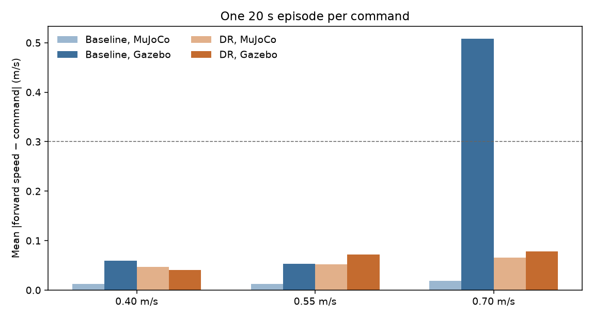

# Sim-to-sim: MuJoCo policies in Gazebo

Both policies are the 10 million-step CPU runs from [dr_comparison.md](dr_comparison.md). `walk_baseline` was trained with domain randomization off and is replayed with no action delay. `walk_dr` was trained with delay included, so it is replayed with one control step of delay (20 ms). Each cell is one deterministic episode of 20 s. The MuJoCo episode uses seed 1 and the same fixed forward command. A success stays upright for the full 20 s and keeps the mean absolute forward-speed error under 0.3 m/s.

The Gazebo robot is a primitive-shape SDF of the Menagerie A1. Link masses and centers of mass follow the MJCF inertial poses. The position actuators use `kp = 100` and no derivative gain, with a force limit of ±33.5 N·m, matching the MuJoCo position actuators. Joint damping stays 1 on the hip and 2 on the thigh and calf. Joint angle zero in Gazebo is the standing pose. The trunk origin is 0.27 m in the file. A zero-command hold settles at 0.258 m, with a maximum joint error of 0.073 rad, and does not fall. No physical robot is in this comparison.

Odometry comes from Gazebo's 3D odometry publisher. With three dimensions that publisher already expresses twist in the trunk frame, and the bridge passes it through. The logged rollouts used the PyTorch actor. The ONNX files `models/walk_baseline.onnx` and `models/walk_dr.onnx` match that actor to about 1e-5 on eight random observations.

## Speed error

| Command | Baseline Gazebo | Baseline MuJoCo | DR Gazebo | DR MuJoCo |
| --- | ---: | ---: | ---: | ---: |
| 0.40 m/s | 0.060 (vx 0.46) | 0.012 (vx 0.40) | 0.041 (vx 0.42) | 0.047 (vx 0.39) |
| 0.55 m/s | 0.053 (vx 0.59) | 0.013 (vx 0.54) | 0.072 (vx 0.50) | 0.053 (vx 0.51) |
| 0.70 m/s | 0.508 (vx 0.21) | 0.018 (vx 0.70) | 0.078 (vx 0.64) | 0.065 (vx 0.64) |

Every episode survived 20 s. None fell. Every cell is a success except the baseline in Gazebo at 0.70 m/s. There the mean speed is 0.21 m/s and the second half of the episode is at rest, while the trunk stays above the fall threshold. The same command stalled on the two preceding Gazebo rollouts as well (mean 0.21 m/s and 0.17 m/s). At 0.40 and 0.55 m/s both policies transfer. At 0.70 m/s the randomized policy keeps 0.64 m/s, close to its MuJoCo speed of 0.64 m/s.



The raw rows are in `results/gazebo_transfer.json` (that directory is gitignored).

## Clip

[sim_vs_gazebo.gif](figures/sim_vs_gazebo.gif) is an 8 s recording of `walk_dr` at 0.70 m/s with one control step of delay. MuJoCo is on the left, Gazebo on the right. The clip uses the ONNX actor. The Gazebo camera is level, with a fixed offset from the trunk, and the floor in that view is a visual checker with no collision. Mean forward speed on that take was 0.62 m/s in MuJoCo and 0.53 m/s in Gazebo. Neither side fell. The 20 s table above is a separate measurement.

```bash
.venv/bin/python -m src.evaluation.record_transfer
```

## ROS 2 node

`a1_policy_bridge` publishes `/a1/joint_states` and `/a1/odom` when the process can import `rclpy`. Joint positions use the Gazebo angle, whose zero is the stand. A second process received 12 joint names, starting at `FR_hip_joint` with a position of about 0, and an odometry message at z = 0.258 m in frame `world` with child `trunk`. Commands to the position controllers go out on gz-transport (`/a1/<joint>/cmd`). The speed table above was recorded with that gz-transport path, before the ROS node was switched on.

```bash
source /opt/ros/lyrical/setup.bash
.venv/bin/python -m src.transfer.gazebo_bridge --seconds 20 --commands 0.4 0.55 0.7
```

Run that from `sim-to-real-rl`. `./scripts/transfer_test.sh` exports both ONNX files and then runs the same comparison.
